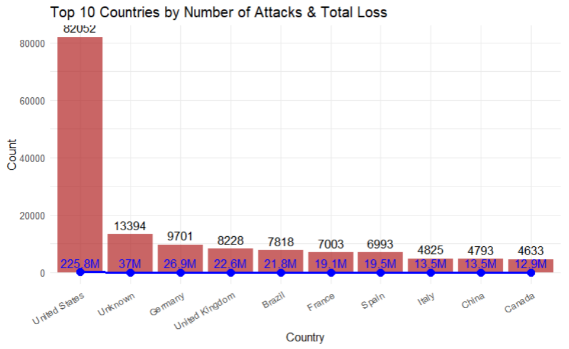
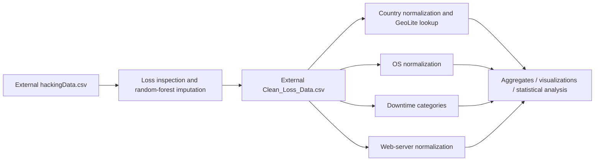

# Web defacement trends: R group analysis

An Asia Pacific University Programming for Data Analysis group project exploring how reported web-defacement incidents relate to country, operating system, web server and downtime. The retained R/R Markdown source covers cleaning, imputation, aggregation, charts and statistical comparisons; an 80-page report preserves the original analysis.

**Status:** historical coursework source and report. The incident dataset and intermediate cleaned CSV are absent, so the analysis cannot run end to end from this clone. The country R Markdown file also has an existing syntax error. Offline R checks identify that blocker and execute one original helper on synthetic input; they do not reproduce the report's findings.



*Original report Figure 6.9, page 36, rendered without changes to its plotted values. This is historical evidence, not a new analysis. Counts and loss annotations use different units; the picture should not be read as a common-scale quantitative comparison.*

## Workflow represented by the source



The work demonstrates R data wrangling and visualization, rather than a live security-monitoring service. Loss cleaning uses `missForest` with Loss, DownTime and a numeric date. Country cleanup combines explicit name mappings and IP geolocation. The other scripts normalize OS/web-server categories and compare downtime groups.

## Files and contribution scope

| Contributor | Retained source |
|---|---|
| Faiyad Mahabub Tasin | `Faiyad (TP077983) Loss Cleaning.Rmd`; `Faiyad (TP077983) Country Clean & EDA.Rmd` |
| Emmanuel Naranendhya Tyatan | `Emmanuel Naranendhya Tyatan - TP078574 (OS Analysis).R` |
| Lau Wei Wen | `Lau Wei Wen TP079439.R` (downtime) |
| Yuke Liew Nyuk Kee | `Yuke Liew Nyuk Kee TP079074.R` (web servers) |

These scopes follow the actual filenames/source. The report records shared group responsibility; the portfolio does not claim individual ownership of the entire analysis. Read the [original group report](PFDA%20Group%20Assignment%20-%20Group15%20%282%29.pdf) for the historical findings.

## Run the safe offline check

With R installed, from the repository root:

```powershell
Rscript --vanilla docs/verify_sources.R
```

The check inventories packages, parses all three `.R` scripts, extracts/parses both R Markdown code streams, executes the original OS mode helper on synthetic values and lists missing inputs. The current check exits **1** because the country notebook contains `country_clean$ <- as.Date(asm_data$Date)` at line 565. This is a known source failure, not a passing full analysis. See [VERIFICATION.md](docs/VERIFICATION.md) for exact results.

For full reproduction, first obtain the authorized incident data and GeoLite database, configure source working directories, resolve the incomplete country assignment and install the source's package requirements. Review interactive `View` calls, in-script `install.packages` calls and output paths before sourcing scripts. They assume RStudio and several contributors' local Windows/macOS directories. There is no unified runner or environment lockfile.

## How to interpret the report

The report describes 212,093 incident observations. Because the CSVs are not retained, this count and its financial totals cannot be checked locally. The archive supports inspection of the original methods and charts, not a fresh measurement of attack frequency or monetary loss.

A high count or aggregate loss for an OS/server is not proof that it is intrinsically more vulnerable: exposure, installed base, reporting and imputation all matter. Dataset shares are not market shares. Units for downtime and loss need reconciliation across the original documentation and plots. Statistical associations should not be described as causal effects, and imputing Loss introduces additional uncertainty.

The [archived project guide](docs/PROJECT_GUIDE.md) preserves the former README with a warning about its obsolete file layout and unverified claims. No LICENSE file or incident-data redistribution terms are included; contributor and dataset rights still apply. No incident-level URLs, IPs or synthetic data masquerading as real evidence have been added.
